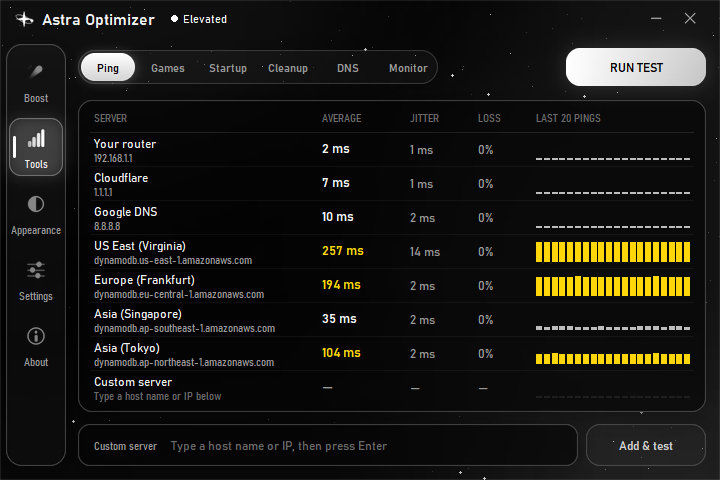
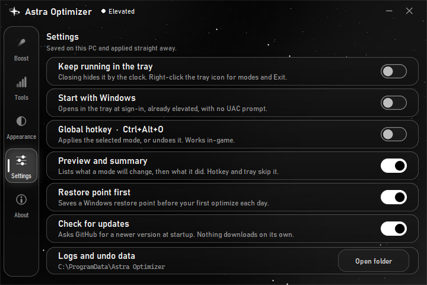
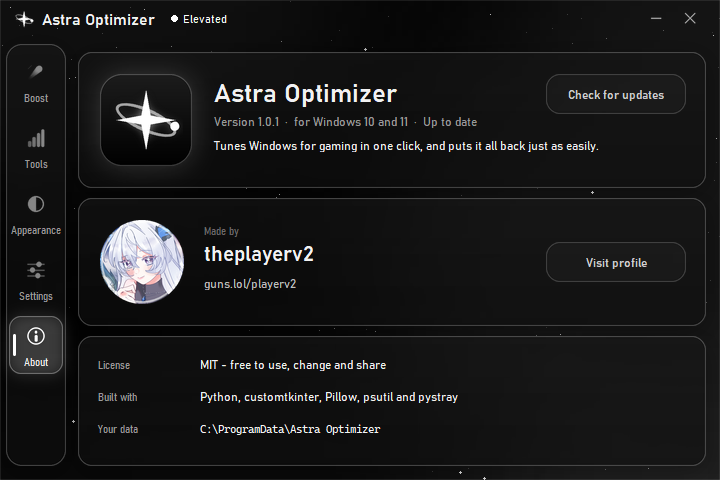

<p align="center">
  
</p>

<h1 align="center">Astra Optimizer</h1>

<p align="center">
  Tunes Windows for gaming in one click, and puts it all back just as easily.
</p>

<p align="center">
  
</p>

## What it does

Pick a mode and press **OPTIMIZE NOW**. Every setting it touches is recorded first, so **UNDO CHANGES**
returns your PC to exactly how *you* had it, not to Windows defaults.

| Mode | What changes |
|---|---|
| **Max FPS** | Ultimate Performance power plan, visual effects set for performance (ClearType stays on), Game Bar capture off and Game Mode on, DNS cache flushed, background services paused until restart (SysMain, telemetry, Search indexer and a few others), and a deep RAM cleanup |
| **Cozy Mode** | High Performance power plan, a gentle RAM cleanup that leaves Discord, Spotify, browsers and the window in front alone, GPU scheduling on, smooth animations |
| **Best Looking** | Full visual effects with transparency and ClearType, Search and SysMain running again, Game Bar back to its defaults (Balanced power plan on laptops running on battery) |

Before anything runs you see a preview of what will change on *your* PC, and afterwards a short summary.

### Tools

- **Ping**: latency, jitter and packet loss to your router, Cloudflare, Google, several cloud regions and any server you type in.
- **Games**: add games by hand or let **Find games** scan Steam, Epic Games, Riot and GOG. Each game gets high CPU priority whenever it runs, an optional *fullscreen optimizations off* switch, and an option to apply your mode while it runs and undo it when it closes.
- **Startup**: turn apps that launch with Windows on or off, using the same switches as Task Manager.
- **Cleanup**: clears old files from your temp folders and old crash reports. Only files untouched for a day are removed, and it asks first.
- **DNS**: measures how fast your current DNS and Cloudflare, Google, Quad9, OpenDNS and AdGuard answer, and switches with one click. *Restore previous* puts your old setting back.
- **Monitor**: live graphs of CPU, GPU, GPU temperature and memory for the last six minutes.

### Appearance and settings

- Starfield, plain black or your own picture as the background, with blur, dim, panel opacity and frost.
- Motion: follow Windows, Full, Reduced or Off.
- Keep running in the tray, start with Windows (elevated, no UAC prompt), a global hotkey (**Ctrl+Alt+O**) to toggle your mode in-game, an optional System Restore point before your first optimize each day, and a check for new versions.

| | |
|---|---|
|  |  |
|  |  |

## Safe by design

- **Undo is exact.** The first value each setting had before Astra Optimizer changed it is saved, so undoing never guesses.
- **Hands off the important parts.** Audio, networking, security, Windows Update and anti-cheat services (Vanguard, Easy Anti-Cheat, BattlEye, FACEIT and others) are never stopped. RAM cleanup skips system processes, Medal and the games in your list.
- **Nothing permanent without asking.** Resetting to Windows defaults, cleaning temp files, switching DNS and turning on System Protection each ask before they run.
- **Paused, not disabled.** Services that Max FPS pauses start again after a restart, or straight away with Undo.

## Download

Get **Astra Optimizer.exe** from the [Releases](../../releases) page and run it. It needs administrator
rights, so Windows asks once (UAC). Without them it still opens, but only to monitor.

When a newer version comes out, the About tab shows a **Download** button that opens its release page.
Astra Optimizer only checks; it never downloads or installs anything by itself, and you can turn the
check off in Settings.

The exe isn't code-signed, so the first launch may show *Windows protected your PC*. Choose **More info**
and then **Run anyway**, or build it yourself from source.

**Requirements:** Windows 10 or 11 (64-bit).

## Build from source

Double-click **`build.bat`**. It:

1. finds Python 3.9 or newer (and installs Python 3.12 with `winget` if there is none),
2. creates a `.venv` and installs the packages in `requirements.txt` plus PyInstaller,
3. renders the app icon into `assets/`,
4. builds a single `dist\Astra Optimizer.exe`.

To run straight from source instead:

```bat
python -m venv .venv
.venv\Scripts\pip install -r requirements.txt
.venv\Scripts\python optimizer.py
```

## Where your data lives

Settings, the undo snapshot, your background picture and the log are stored in
`C:\ProgramData\Astra Optimizer`. **Settings → Open folder** takes you there.

## Uninstall

1. Press **UNDO CHANGES** if a mode is applied, and turn off **Start with Windows** in Settings.
2. Exit from the tray icon, then delete `Astra Optimizer.exe`.
3. Delete `C:\ProgramData\Astra Optimizer` to remove its settings and log.

## Credits

Made by **theplayerv2**: [guns.lol/playerv2](https://guns.lol/playerv2)

Built with Python, [customtkinter](https://github.com/TomSchimansky/CustomTkinter),
[Pillow](https://python-pillow.org), [psutil](https://github.com/giampaolo/psutil) and
[pystray](https://github.com/moses-palmer/pystray).

## License

[MIT](LICENSE). Free to use, change and share.
