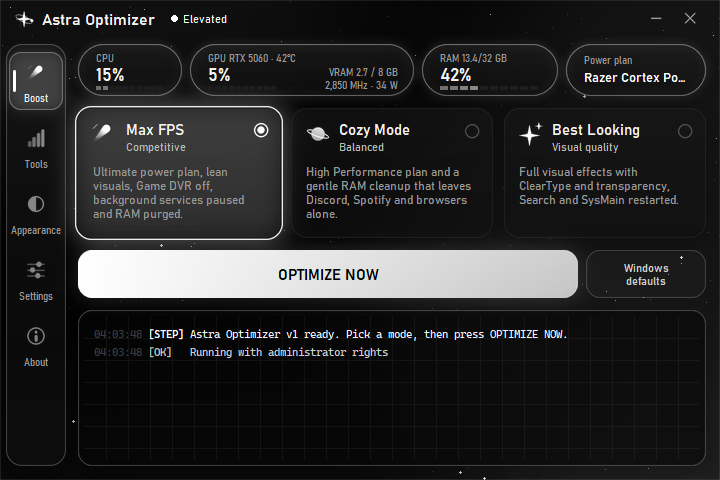
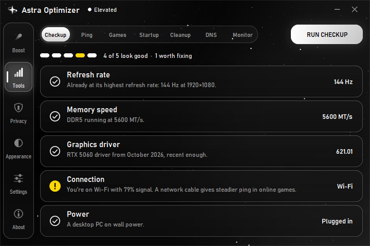
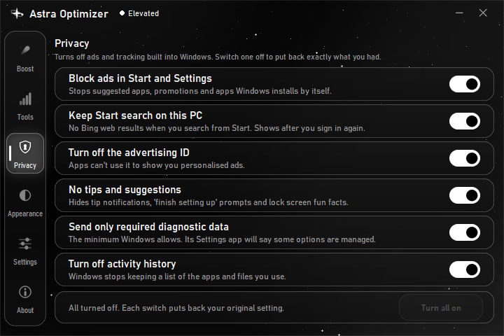
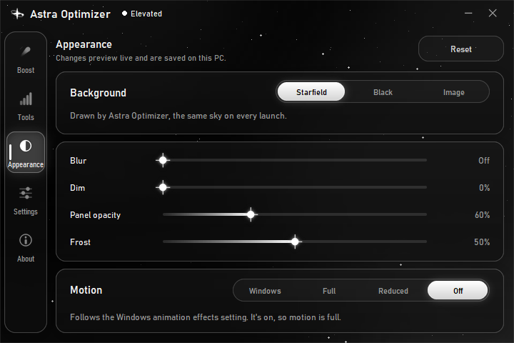
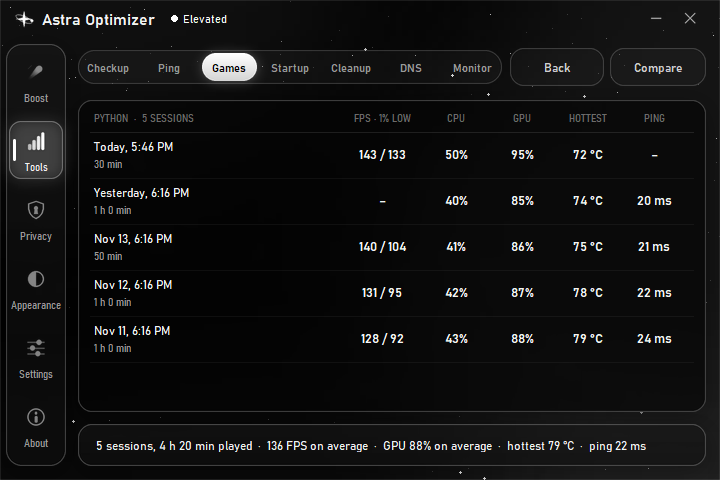
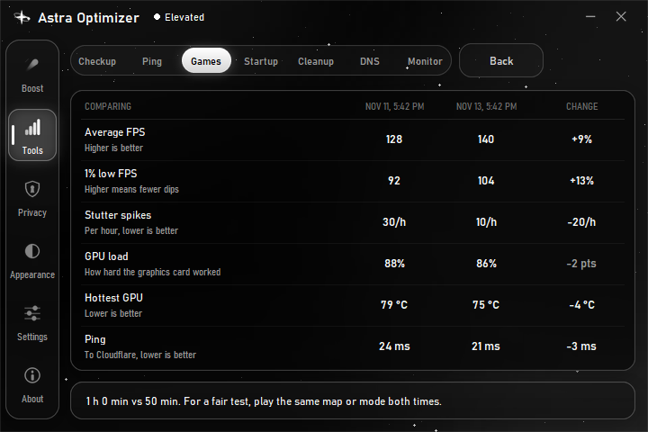

<p align="center">
  
</p>

<h1 align="center">Astra Optimizer</h1>

<p align="center">
  Tunes Windows for gaming in one click, and puts it all back just as easily.
</p>

<p align="center">
  <a href="../../releases/latest"></a>
  <a href="../../actions/workflows/build.yml"></a>
</p>

<p align="center">
  
</p>

## What it does

Pick a mode and press **OPTIMIZE NOW**. Every setting it touches is recorded first, so **UNDO CHANGES**
returns your PC to exactly how *you* had it, not to Windows defaults.

| Mode | What changes |
|---|---|
| **Max FPS** | Ultimate Performance power plan, visual effects set for performance (ClearType stays on), Game Bar capture off and Game Mode on, optimizations for windowed games and variable refresh rate on, NVIDIA power management at Prefer maximum performance and Low Latency Mode on, DNS cache flushed, background services paused until restart (SysMain, telemetry, Search indexer and a few others), and a deep RAM cleanup |
| **Cozy Mode** | High Performance power plan, a gentle RAM cleanup that leaves Discord, Spotify, browsers and the window in front alone, GPU scheduling on, optimizations for windowed games and variable refresh rate on, NVIDIA Low Latency Mode on, smooth animations |
| **Best Looking** | Full visual effects with transparency and ClearType, Search and SysMain running again, Game Bar back to its defaults (Balanced power plan on laptops running on battery) |

Before anything runs you see a preview of what will change on *your* PC, and afterwards a short summary.

### Tools

- **Checkup**: one scan for settings that quietly cost performance: a monitor below its top refresh rate (fixed in one click), RAM below its rated speed (XMP/EXPO off), an old graphics driver, games running on a laptop's built-in graphics instead of its fast GPU, a graphics card in a slow slot, Game Mode or windowed-game optimizations off, Memory Integrity's FPS cost (explained, never changed for you), a nearly full drive or TRIM off, Wi-Fi or a slow cable link, and a laptop on battery. A score shows how many look good.
- **Ping**: latency, jitter and packet loss to your router, Cloudflare, Google, several cloud regions and any server you type in.
- **Games**: add games by hand or let **Find games** scan Steam, Epic Games, Riot and GOG. Each game gets high CPU priority whenever it runs, is kept out of Windows' power throttling (EcoQoS), runs on the fast GPU on laptops with two graphics chips, an optional *fullscreen optimizations off* switch, and an option to apply your mode while it runs and undo it when it closes.
- **Session reports and FPS**: while a game runs, Astra measures its real frame rate with Intel's PresentMon (it reads Windows' own frame timing, nothing is injected into the game). When the game closes you get average FPS, 1% lows, stutter spikes, CPU and GPU load, the hottest GPU temperature and ping. Click a game to see all its sessions with averages, and **Compare** any two of them side by side, for example before and after Max FPS. A slim **live overlay** shows FPS, a frame-time graph, 1% low, GPU, CPU and ping while you play; it opens with your game, **Ctrl+Alt+F** or the tray menu toggles it, and right-clicking it sets its background (clear, glass or solid), size and readings, or locks it in place.
- **Startup**: turn apps that launch with Windows on or off, using the same switches as Task Manager.
- **Cleanup**: clears old files from your temp folders, crash reports, Discord's cache, used Windows Update downloads and the Delivery Optimization cache. Only files untouched for a day are removed, and it asks first. It can also run by itself once a week, never while a game is running.
- **DNS**: measures how fast your current DNS and Cloudflare, Google, Quad9, OpenDNS and AdGuard answer, and switches with one click. *Restore previous* puts your old setting back.
- **Monitor**: live graphs of CPU, GPU, GPU temperature and memory for the last six minutes.

### Privacy

Six switches for ads and tracking built into Windows: ads and suggested apps in Start and Settings, Bing results in Start search, the advertising ID, tips and lock screen fun facts, diagnostic data (down to the required minimum) and activity history. Each switch saves the exact values it replaces, and turning it off puts them back. None of these change performance; they're about privacy and clutter.

### Appearance and settings

- Starfield, plain black or your own picture as the background, with blur, dim, panel opacity and frost.
- Motion: follow Windows, Full, Reduced or Off.
- Keep running in the tray, start with Windows (elevated, no UAC prompt), a global hotkey (**Ctrl+Alt+O**) to toggle your mode in-game, an optional System Restore point before your first optimize each day, a check for new versions, and **Back up / Restore** to move your settings, games, appearance and session history to another PC in one file.
- **Report a problem** (About tab or tray menu) saves one zip to your desktop with your PC specs, a fresh checkup, your last game sessions and the app's log and settings, ready to send with a bug report.

| | |
|---|---|
|  |  |
|  |  |
|  |  |

## Safe by design

- **Undo is exact.** The first value each setting had before Astra Optimizer changed it is saved, so undoing never guesses.
- **Hands off the important parts.** Audio, networking, security, Windows Update and anti-cheat services (Vanguard, Easy Anti-Cheat, BattlEye, FACEIT and others) are never stopped. RAM cleanup skips system processes, Medal and the games in your list.
- **Nothing permanent without asking.** Resetting to Windows defaults, cleaning temp files, switching DNS, restoring a backup and turning on System Protection each ask before they run. Weekly cleanup only runs if you switch it on.
- **Paused, not disabled.** Services that Max FPS pauses start again after a restart, or straight away with Undo.

## Download

Get **Astra.Optimizer.exe** from the [latest release](../../releases/latest) and run it. It needs
administrator rights, so Windows asks once (UAC). Without them it still opens, but only to monitor.

Every release is built by GitHub Actions straight from that version's source code, and its notes list
the exe's SHA-256 checksum. What changed in each version is in [CHANGELOG.md](CHANGELOG.md).

When a newer version comes out, the About tab shows **Update to vN.N.N**. Clicking it downloads that
release's exe from GitHub, checks it against the SHA-256 in the release notes, and restarts Astra on the
new version; your settings, games and any applied mode carry over. Nothing downloads until you click,
and you can turn the check off in Settings.

The exe isn't code-signed, so the first launch may show *Windows protected your PC*. Choose **More info**
and then **Run anyway**, or build it yourself from source.

**Requirements:** Windows 10 or 11 (64-bit).

## Build from source

Double-click **`build.bat`**. It:

1. finds Python 3.9 or newer (and installs Python 3.12 with `winget` if there is none),
2. creates a `.venv` and installs the packages in `requirements.txt` plus PyInstaller,
3. renders the app icon into `assets/`,
4. builds a single `dist\Astra Optimizer.exe`.

To run straight from source instead:

```bat
python -m venv .venv
.venv\Scripts\pip install -r requirements.txt
.venv\Scripts\python optimizer.py
```

### Making a release

1. Set `APP_VERSION` and `DISPLAY_VERSION` at the top of `optimizer.py` (for example `1.3.0` and `v1.3.0`).
2. Add a `## v1.3.0 - YYYY-MM-DD` section to `CHANGELOG.md`.
3. Commit, then tag and push:

   ```bat
   git tag v1.3.0
   git push origin main v1.3.0
   ```

GitHub Actions builds the exe on a clean Windows machine and publishes the release with the changelog
section as its notes. The run stops before publishing if the tag doesn't match `DISPLAY_VERSION` or the
changelog has no section for it. Every push to `main` is also built, so a broken build shows up early.

## Where your data lives

Settings, the undo snapshot, your background picture and the log are stored in
`C:\ProgramData\Astra Optimizer`. **Settings → Open folder** takes you there.

## Uninstall

1. Press **UNDO CHANGES** if a mode is applied, and turn off **Start with Windows** in Settings.
2. Exit from the tray icon, then delete `Astra Optimizer.exe`.
3. Delete `C:\ProgramData\Astra Optimizer` to remove its settings and log.

## Credits

Made by **theplayerv2** ([GitHub](https://github.com/theplayerv2)).

Built with Python, [customtkinter](https://github.com/TomSchimansky/CustomTkinter),
[Pillow](https://python-pillow.org), [psutil](https://github.com/giampaolo/psutil),
[pystray](https://github.com/moses-palmer/pystray) and [Intel PresentMon](https://github.com/GameTechDev/PresentMon)
(bundled under its MIT license, see `assets/presentmon/LICENSE.txt`).

## License

[MIT](LICENSE). Free to use, change and share.
